

<a href="https://github.com/jossmair/Ergonatus/releases/latest">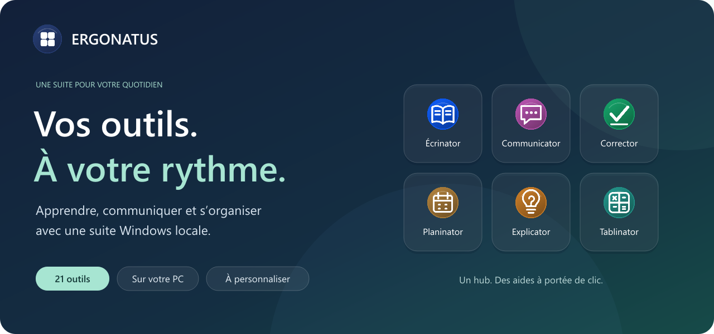</a>

### Une suite pour apprendre, s’exprimer et gagner en autonomie.

**Choisissez les aides qui vous sont utiles. Retrouvez-les dans un seul hub.**

Pour les élèves, les familles, les enseignants et les personnes qui les accompagnent.

<a href="#installation-windows">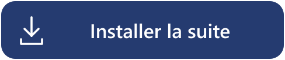</a>&nbsp;&nbsp;<a href="#version-portable">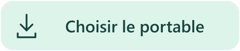</a>

[Découvrir les outils](#21-outils-à-composer-selon-vos-besoins) · [Voir les téléchargements](https://github.com/jossmair/Ergonatus/releases/latest) · [Construire depuis les sources](BUILDING.md)

---

<table><tr>
<td width="33%" valign="top"><h3>Votre sélection</h3>
Activez vos outils, personnalisez votre profil et retrouvez vos aides dans leurs petites Orbs flottantes.
</td>
<td width="33%" valign="top"><h3>Sur votre ordinateur</h3>
Les moteurs d’IA, les voix et le dictionnaire sont fournis dans la distribution. Aucun compte Ergonatus à créer.
</td>
<td width="33%" valign="top"><h3>Des usages concrets</h3>
Écrire un cours, écouter un texte, exprimer un besoin, comprendre une consigne ou préparer sa semaine.
</td>
</tr></table>

## Un point d’entrée. Vos outils à portée de clic.

Un clic sur l’Orb d’Ergonatus affiche le catalogue. Chaque outil garde **son nom, sa couleur et sa fonction** : choisissez, lancez, retrouvez.

<a href="docs/media/catalogue.png">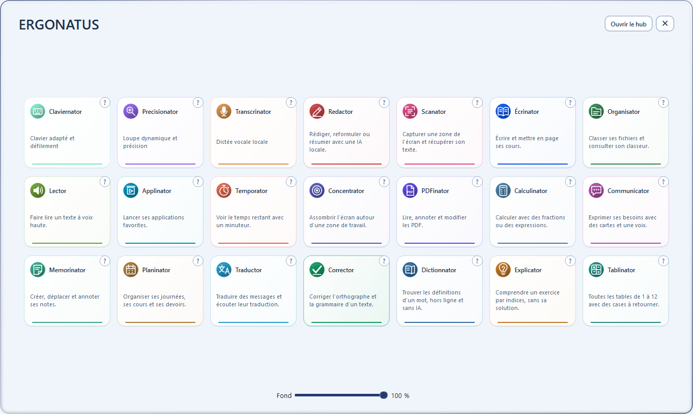</a>

Vraies interfaces de la version v2026.10.27, avec des exemples de démonstration. Cliquez sur une capture pour l’agrandir.

## Écrire, lire et mettre ses idées en forme

### Écrinator — des cours dans lesquels on se repère

Matières, bandeaux, encadrés et formules : construisez des documents scolaires avec des repères visuels. Retrouvez vos cours et exportez vos documents.

<a href="docs/media/ecrinator.png">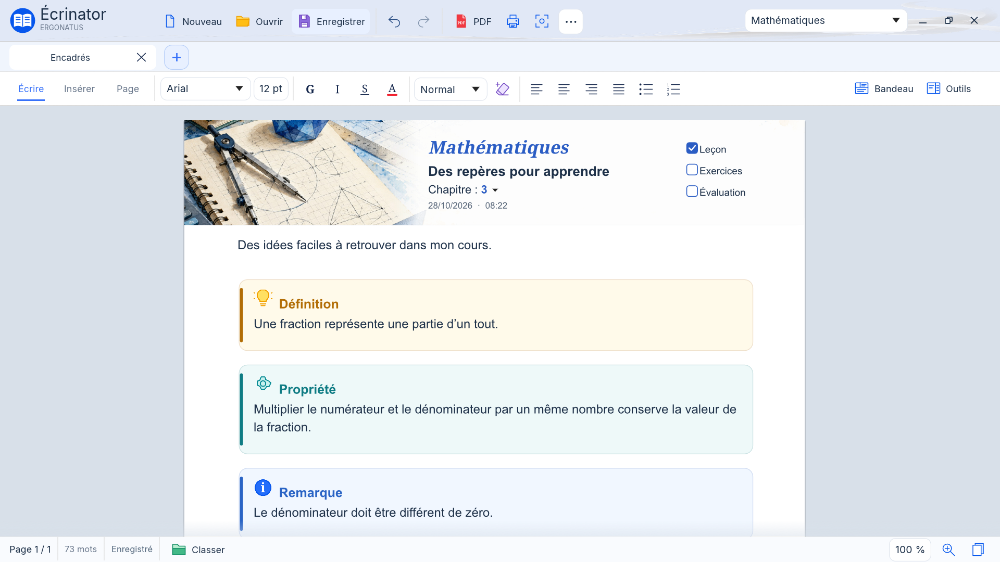</a>

<table><tr><td width="50%" valign="top"><h3>Corrector · garder le fil de ses idées</h3>
Le texte envoyé à gauche, la proposition corrigée à droite. Sélectionnez, relisez et copiez la réponse dans une interface de discussion.
<a href="docs/media/corrector.png">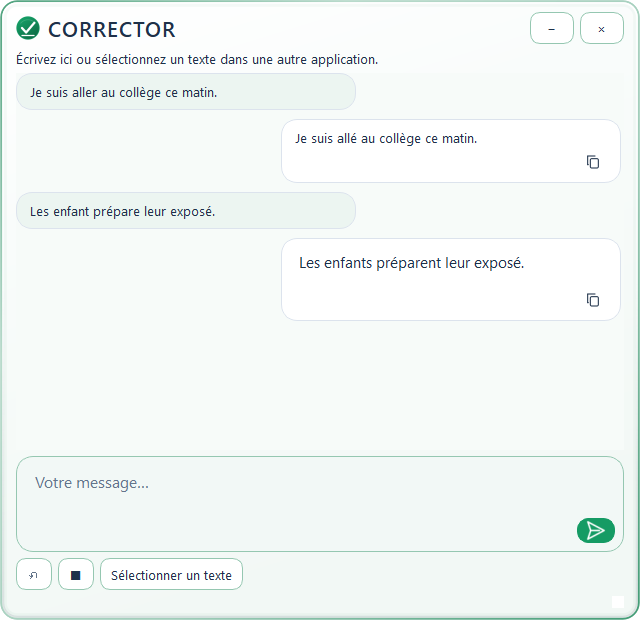</a></td><td width="50%" valign="top"><h3>Communicator · trouver comment le dire</h3>
Des cartes pour exprimer ses besoins et ses choix. Préparez un message, montrez-le en grand ou faites-le lire à voix haute.
<a href="docs/media/communicator.png">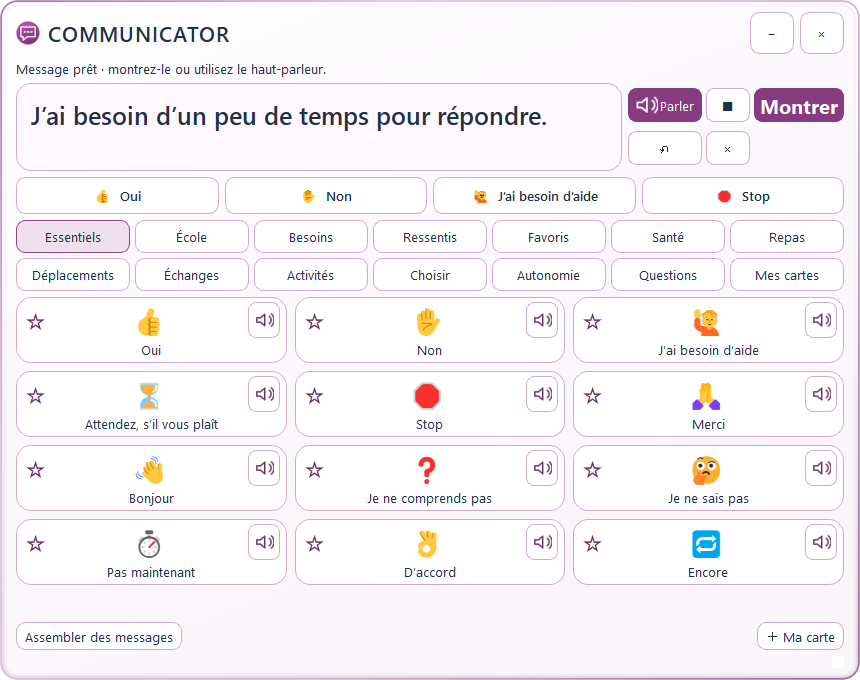</a></td></tr></table>

## Comprendre et s’entraîner, une étape à la fois

<table><tr><td width="50%" valign="top"><h3>Explicator · une piste pour avancer</h3>
Capturez une consigne ou collez un énoncé. Demandez une explication et des indices pour chercher par vous-même.
<a href="docs/media/explicator.png">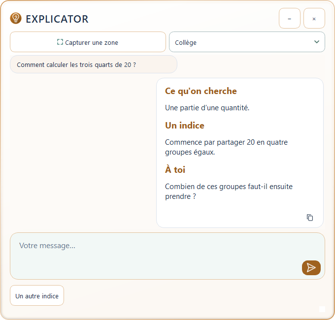</a></td><td width="50%" valign="top"><h3>Tablinator · cliquer, retourner, retenir</h3>
Toutes les tables de 1 à 12 dans une grille. Cliquez sur une opération pour retourner sa carte et découvrir le résultat.
<a href="docs/media/tablinator.png">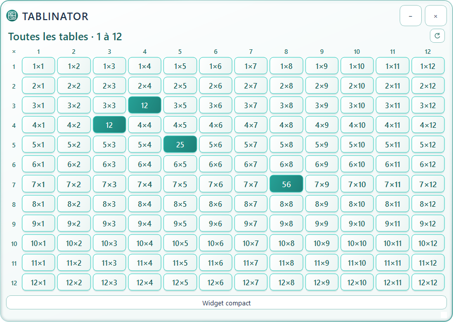</a></td></tr></table>

## Une semaine plus facile à retrouver

**Planinator** réunit les activités, les cours et les devoirs. Le mode élève donne une couleur à chaque matière ; l’Orb permet de retrouver le widget d’aujourd’hui et de demain.

<a href="docs/media/planinator.png">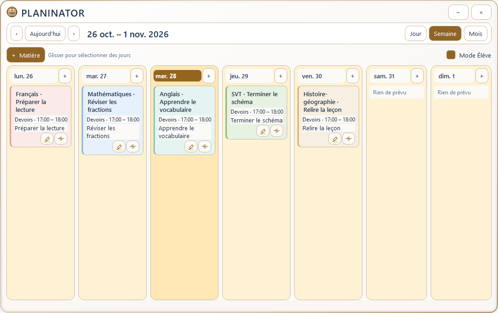</a>

<strong>Voir aussi : post-it, traduction, dictionnaire et calculatrice</strong>

 

### Memorinator — poser une idée, la retrouver plus tard

Un mur de post-it datés, colorés et déplaçables. Ajoutez vos notes, surlignez, barrez et ajustez l’opacité du fond.

<a href="docs/media/memorinator.png">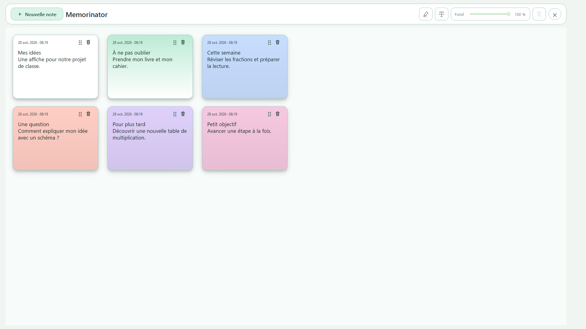</a>

### Traductor — une discussion dans deux langues

Choisissez les langues, écrivez votre message, puis écoutez ou copiez la traduction depuis sa bulle.

<a href="docs/media/traductor.png">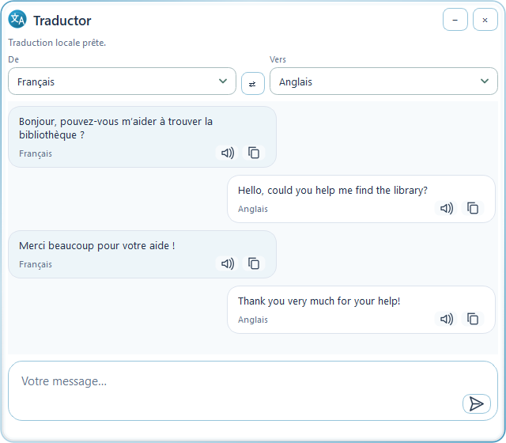</a>

### Dictionnator — les mots et leurs sens

Un dictionnaire français local, avec définitions et suggestions pendant la saisie.

<a href="docs/media/dictionnator.png">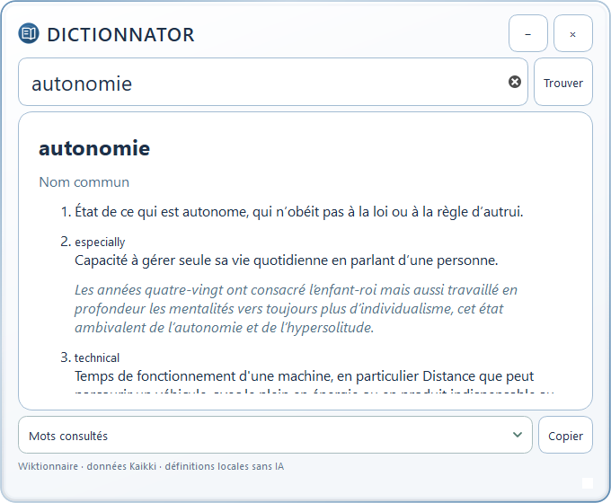</a>

### Calculinator — des nombres aux expressions

Un clavier à la souris, un historique et un mode élève pour les fractions et le calcul symbolique.

<a href="docs/media/calculinator.png">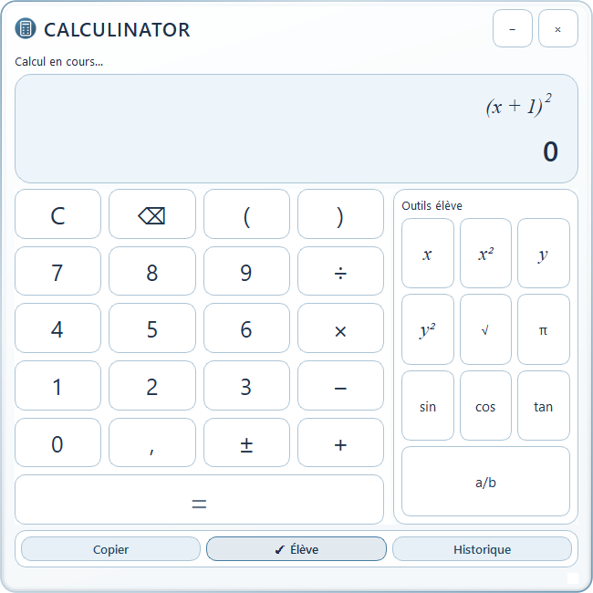</a>

## 21 outils à composer selon vos besoins

<strong>Explorer le catalogue complet</strong>

 

| Outil | Pour quoi faire ? |
|:---|:---|
| 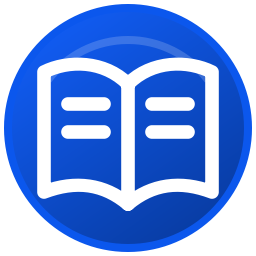 **Écrinator** | Écrire et mettre en page ses cours. |
| 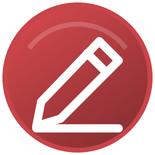 **Redactor** | Rédiger, reformuler ou résumer avec une IA locale. |
| 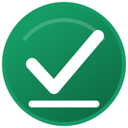 **Corrector** | Corriger l’orthographe et la grammaire d’un texte. |
| 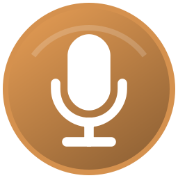 **Transcrinator** | Dictée vocale locale |
| 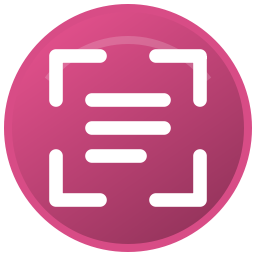 **Scanator** | Capturer une zone de l’écran et récupérer son texte. |
|  **Lector** | Faire lire un texte à voix haute. |
| 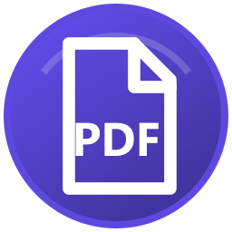 **PDFinator** | Lire, annoter et modifier les PDF. |
| 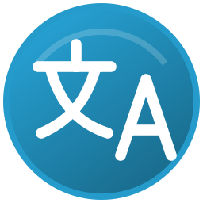 **Traductor** | Traduire des messages et écouter leur traduction. |
| 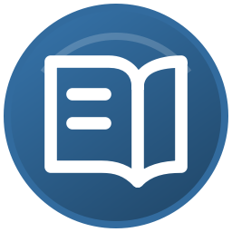 **Dictionnator** | Trouver les définitions d’un mot, hors ligne et sans IA. |
|  **Explicator** | Comprendre un exercice par indices, sans sa solution. |
| 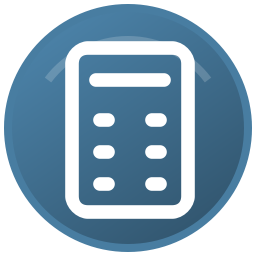 **Calculinator** | Calculer avec des fractions ou des expressions. |
| 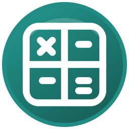 **Tablinator** | Toutes les tables de 1 à 12 avec des cases à retourner. |
|  **Communicator** | Exprimer ses besoins avec des cartes et une voix. |
| 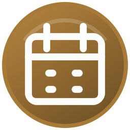 **Planinator** | Organiser ses journées, ses cours et ses devoirs. |
| 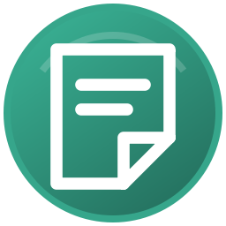 **Memorinator** | Créer, déplacer et annoter ses notes. |
| 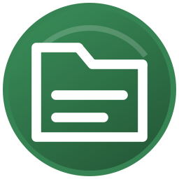 **Organisator** | Classer ses fichiers et consulter son classeur. |
| 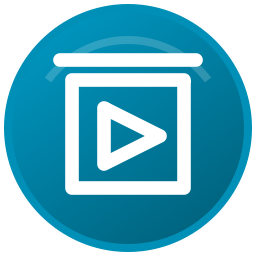 **Applinator** | Lancer ses applications favorites. |
| 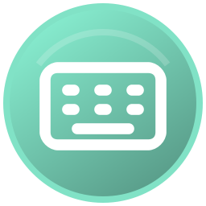 **Claviernator** | Clavier adapté et défilement |
| 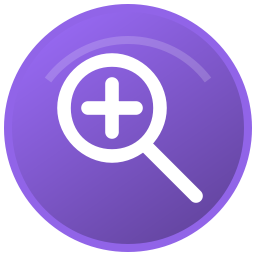 **Precisionator** | Loupe dynamique et précision |
| 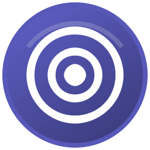 **Concentrator** | Assombrir l’écran autour d’une zone de travail. |
| 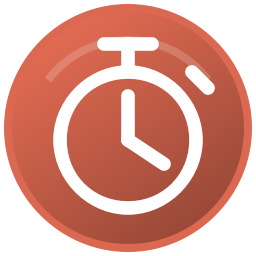 **Temporator** | Voir le temps restant avec un minuteur. |

## Prêt à choisir vos outils ?

**Deux formats, la même suite complète. Choisissez celui qui vous convient.**

Les voix, les modèles d’IA et le dictionnaire sont inclus. Les téléchargements sont donc volumineux et découpés en plusieurs fichiers.

### Installation Windows

1. Ouvrez les **[téléchargements de la dernière version](https://github.com/jossmair/Ergonatus/releases/latest)**.
2. Prenez **`Ergonatus-…-Setup.exe` et tous les fichiers `Ergonatus-…-Setup-*.bin`**.
3. Placez-les dans le même dossier et ouvrez **Setup.exe**.

### Version portable

1. Ouvrez les **[téléchargements de la dernière version](https://github.com/jossmair/Ergonatus/releases/latest)**.
2. Prenez **tous les volumes `Ergonatus-…-portable.zip.001`, `.002`, etc.**, ainsi que **`7za.exe`** et **`Extraire-portable.cmd`**.
3. Placez-les dans le même dossier, ouvrez **Extraire-portable.cmd**, puis **Portable → Ergonatus → Lancer Ergonatus.cmd**.

> Gardez tous les sous-dossiers de la suite. Aucun Python installé n’est nécessaire pour utiliser les téléchargements prêts à l’emploi.

### Les premiers pas

**Ouvrez le hub → choisissez votre profil → activez vos outils → retrouvez leurs Orbs.**

Le clic droit ouvre le menu de chaque Orb. Son aide précise ses gestes et ses raccourcis. Quitter Ergonatus arrête les applications de la suite.

<strong>Informations utiles, sources et licences</strong>

 

- **Plateforme :** Windows 10/11 x64.
- **Ressources :** les modèles et voix sont fournis ; l’OCR dépend des langues Windows installées.
- **Stockage :** prévoyez de la place pour les volumes et la suite extraite, d’environ 11 Go pour la version illustrée.
- **Données :** les outils récents utilisent `Data` avec le lanceur portable. Certaines préférences historiques restent dans leur emplacement Windows habituel.
- **IA :** les corrections, traductions et explications sont des propositions à relire.
- **Sélections :** le remplacement automatique dépend de la compatibilité de l’application cible ; la copie reste disponible.
- **Windows :** les exécutables ne sont pas signés ; un avertissement de réputation peut apparaître.
- **Intégrité :** les téléchargements sont accompagnés de `SHA256SUMS.txt`.
- **Développement :** voir [BUILDING.md](BUILDING.md). Les ressources volumineuses sont distribuées séparément des sources.
- **Licences :** chaque composant conserve sa licence. Les notices sont fournies dans ses dossiers ; le dictionnaire dérive du Wiktionnaire via Kaikki.
- **Visuels :** voir les [informations sur les captures](docs/media/README.md).

---

<strong>ERGONATUS</strong> Vos outils. À votre rythme. <a href="https://github.com/jossmair/Ergonatus/releases/latest">Télécharger la suite</a> · <a href="https://github.com/jossmair/Ergonatus/issues">Poser une question ou signaler un problème</a>

